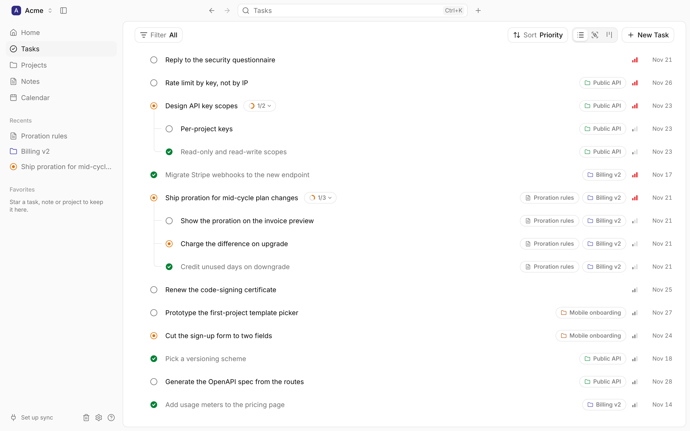
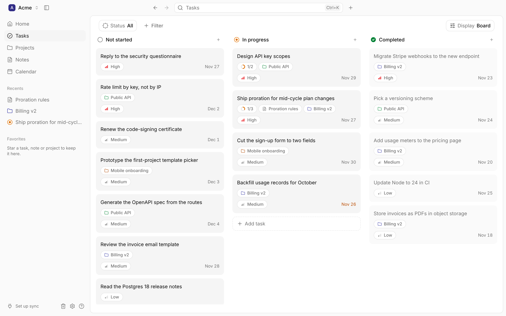
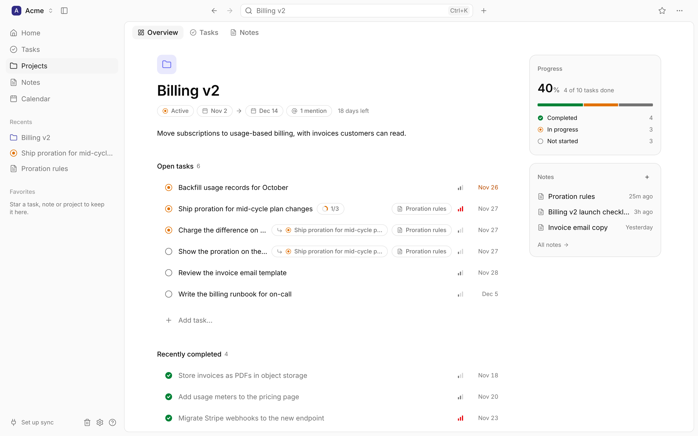
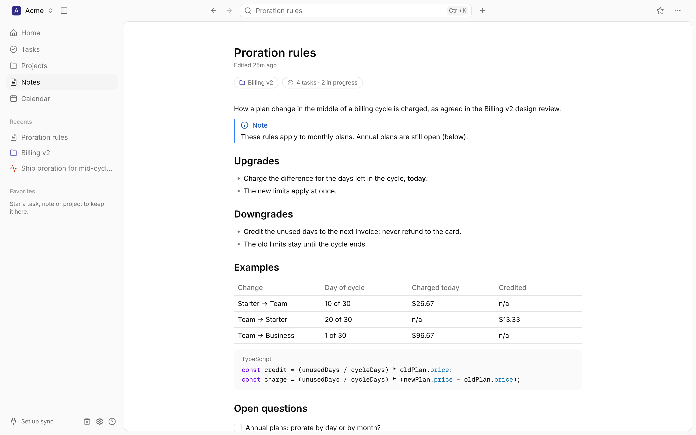
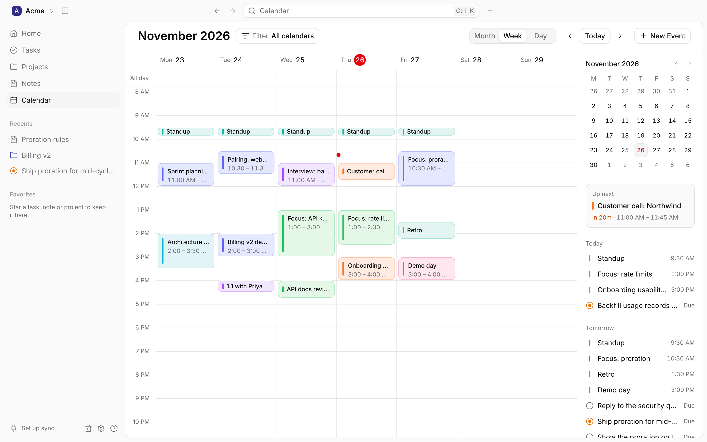

<div align="center">
  <picture>
    <source media="(prefers-color-scheme: dark)" srcset="src/renderer/assets/devbrain-logomark.svg" />
    
  </picture>

  <h1>DevBrain</h1>

  <p><strong>The second brain for developers.</strong><br />
  Your tasks, projects, notes and calendar, in one desktop app that runs on your computer.</p>

  <p>
    <a href="https://devbrainapp.dev">Website</a> ·
    <a href="https://devbrainapp.dev/download/">Download</a> ·
    <a href="https://devbrainapp.dev/docs/">Docs</a> ·
    <a href="https://devbrainapp.dev/changelog/">Changelog</a>
  </p>

  <p>
    <a href="LICENSE"></a>
    
    
  </p>
</div>

<br />

<picture>
  <source media="(prefers-color-scheme: dark)" srcset="website/src/assets/screenshots/tasks-dark.png" />
  
</picture>

## What it is

DevBrain organises your working life around four things (**tasks, notes, projects and events**)
and the links between them: a task to its project, a note to its meeting. So you always have a
clear picture of what you're working on and when, and can pick your work back up after a week
away.

It's personal, not a team tool, and it stays out of your way: quick to put things in, quicker to
find them again.

## Features

<table>
  <tr>
    <td width="50%" valign="top">
      <h3>Tasks</h3>
      <p>Lists and boards grouped by status, with priorities, dates, subtasks, and links to the projects, notes and events they belong to.</p>
      <picture>
        <source media="(prefers-color-scheme: dark)" srcset="website/src/assets/screenshots/board-dark.png" />
        
      </picture>
    </td>
    <td width="50%" valign="top">
      <h3>Projects</h3>
      <p>Each project's open and recently finished tasks, its notes, and its progress at a glance.</p>
      <picture>
        <source media="(prefers-color-scheme: dark)" srcset="website/src/assets/screenshots/project-dark.png" />
        
      </picture>
    </td>
  </tr>
  <tr>
    <td width="50%" valign="top">
      <h3>Notes</h3>
      <p>A rich text editor that reads and writes Markdown: checklists, tables, callouts and highlighted code, saved as plain files you own.</p>
      <picture>
        <source media="(prefers-color-scheme: dark)" srcset="website/src/assets/screenshots/note-dark.png" />
        
      </picture>
    </td>
    <td width="50%" valign="top">
      <h3>Calendar</h3>
      <p>Your week on a time grid, with today's agenda, the tasks that are due, and the meeting up next.</p>
      <picture>
        <source media="(prefers-color-scheme: dark)" srcset="website/src/assets/screenshots/calendar-dark.png" />
        
      </picture>
    </td>
  </tr>
</table>

And around them:

- **Search everything** with ⌘K (Ctrl K on Windows and Linux): tasks, projects, notes and events.
- **Linear and Google Calendar,** mirrored in read-only: the issues assigned to you, and the events
  of the calendars you choose, beside your own work.
- **Import and export:** tasks as CSV or JSON, notes as Markdown.

## Local first

- **Your work stays on your computer.** Each workspace is a folder: a SQLite database and your
  notes as Markdown files. Copy the folder to move it to another computer.
- **No account and no DevBrain server.** It works offline, and sends no analytics or telemetry.
- **Integrations talk to Linear and Google directly,** with your sign-ins encrypted in your
  system's keychain.

The [privacy policy](https://devbrainapp.dev/privacy/) has the details.

## Download

DevBrain is for macOS (Apple silicon and Intel), Windows and Linux. It hasn't had its first
release yet: installers will be on the [download page](https://devbrainapp.dev/download/) and the
[GitHub releases](https://github.com/MitchellMarkGeorge/devbrain/releases). Until then, you can
build it from source:

```bash
git clone https://github.com/MitchellMarkGeorge/devbrain.git
cd devbrain
npm install
npm run seed:dev   # a sample workspace to try it with
npm run dev
```

You'll need Node.js 24. [CONTRIBUTING.md](CONTRIBUTING.md) covers the rest.

## Contributing

Bug reports and pull requests are welcome. [CONTRIBUTING.md](CONTRIBUTING.md) explains how to get
a development build running, how the app is built, and the rules the codebase follows.

## License

[MIT](LICENSE) © Mitchell Mark-George
